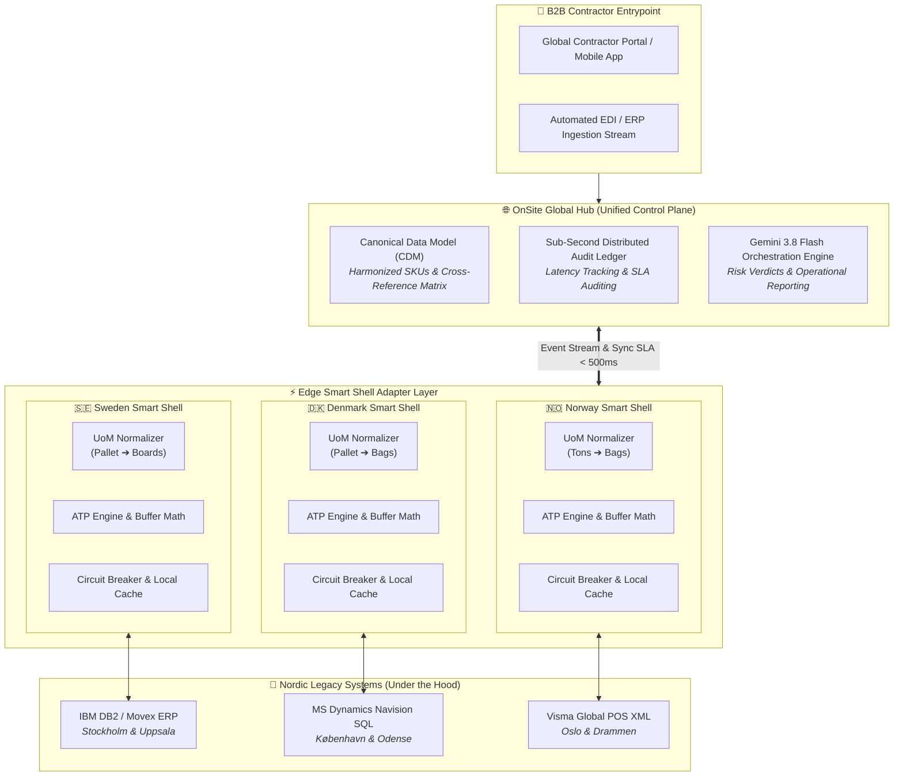
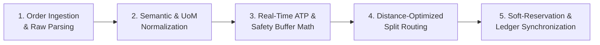
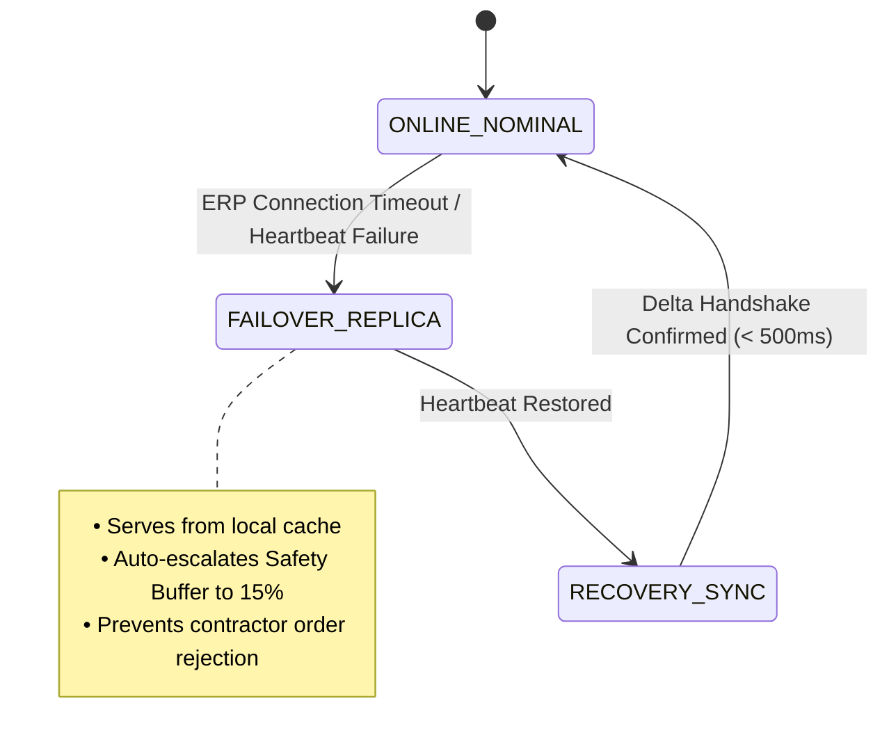

<div align="center">

# 🏗️ OnSite — The Delivery Promise Platform
### Next-Generation Smart Shell Integration Middleware for Nordic B2B Supply Chains

[](https://netcompany.com)
[](https://github.com/huynh-phong/OnSite)
[](https://vercel.com)
[](https://ai.google.dev)
[](https://react.dev)
[](https://vitejs.dev)

<p align="center">
  <b>Harmonizing fragmented Nordic legacy ERPs (Movex DB2, MS Navision, Visma Global) into a unified, high-reliability Global Hub with sub-second Available-to-Promise (ATP), dynamic safety buffers, autonomous split-routing, and Gemini AI-driven operational reporting.</b>
</p>

---

</div>

## 📌 Executive Summary & Problem Statement

In the high-stakes Nordic construction sector, project schedules are dictated by tight delivery windows. A contractor operating on a job site (such as Slussen in Stockholm or Sydhavn in Copenhagen) cannot tolerate missed deliveries; a single late delivery can trigger severe contractual Service Level Agreement (**SLA**) penalties, idle crane costs, and cascading project delays.

However, multinational building materials distributors face a deeply entrenched legacy challenge:

```
┌────────────────────────────────────────────────────────────────────────────────────────┐
│                                LEGACY OPERATIONAL REALITY                              │
├────────────────────────────┬─────────────────────────────┬─────────────────────────────┤
│ 🇸🇪 Sweden                  │ 🇩🇰 Denmark                  │ 🇳🇴 Norway                   │
│ • Movex ERP (IBM DB2)      │ • MS Dynamics Navision (SQL)│ • Visma Global POS (XML)    │
│ • Local SKU: SE-GIPS-13    │ • Local SKU: DK-CEM-01      │ • Local SKU: NO-MUR-250     │
│ • UoM: Pallets (1 = 40 St) │ • UoM: Metric Tons (1 = 40) │ • UoM: Pallets (1 = 40 Sæk) │
│ • Polling Delay: Batch sync│ • Polling Delay: On-demand  │ • Polling Delay: Periodic   │
└────────────────────────────┴─────────────────────────────┴─────────────────────────────┘
                                           │
                         ▼ LACK OF UNIFIED ORCHESTRATION ▼
       • Phantom Inventory & Accidental Double-Allocation
       • Zero Cross-Border or Multi-Branch Visibility
       • Severe SLA Penalties & Lost Contractor Trust
```

**OnSite** solves this systemic challenge through a non-invasive **Smart Shell (Adapter Layer) Architecture**. Rather than executing a high-risk, multi-million dollar "rip-and-replace" ERP migration, OnSite encapsulates legacy systems with lightweight, edge-compatible adapters that normalize unit metrics, dynamically compute Available-to-Promise inventory, split-route order shortfalls across secondary regional branches, and synchronize an immutable distributed audit ledger in under **500 ms**.

---

## 🏛️ High-Level System Architecture

OnSite implements an event-driven, micro-adapter architecture that bridges heterogeneous country nodes to a central Global Hub while providing full autonomy during network or ERP outages.



---

## ⚙️ Core Engineering Capabilities

### 1. 🔄 5-Step Order Execution & Delivery Promise Pipeline

Every incoming order payload passes through a deterministic 5-stage transformation pipeline:



1. **Step 1 — Ingestion & Syntax Translation**: Ingests raw order strings and unstructured payloads from legacy terminals and EDI connections across diverse regional protocols.
2. **Step 2 — Semantic & UoM Harmonization**: Automatically converts country-specific units (e.g., *Sæk*, *Styck*, *Pall*, *Tonn*) into canonical base units (*Boards*, *Bags*, *Tons*) using canonical multiplier algorithms.
3. **Step 3 — ATP & Safety Buffer Math**: Calculates deterministic Available-To-Promise stock while reserving dynamic, policy-driven safety buffers:
   $$\text{Safety Buffer} = \lceil \text{Physical Stock} \times \text{Buffer Rate} \rceil$$
   $$\text{Net ATP} = \max(0, \text{Physical Stock} - \text{Safety Buffer} - \text{Soft Reserved})$$
4. **Step 4 — Multi-Branch Split Routing Engine**: Evaluates primary branch net capacity against demanded quantities. If an allocation deficit is detected, the engine dynamically calculates split quantities and routes the remainder to the nearest secondary warehouse without violating SLA transit times.
5. **Step 5 — Distributed Soft-Lock & Ledger Sync**: Writes a transient two-phase soft lock to prevent race conditions from concurrent order streams, followed by an immediate broadcast to the Global Audit Ledger.

---

### 2. 🛡️ Autonomous Circuit Breaker & Failover Architecture

Network instability and legacy database maintenance downtime represent critical failure points in traditional integrations. OnSite's Smart Shell incorporates an autonomous **Circuit Breaker Pattern**:

| System State | Adapter Behavior | Buffer Policy | Data Source |
| :--- | :--- | :--- | :--- |
| **ONLINE_NOMINAL** | Direct pass-through reads/writes with bi-directional delta synchronization. | Standard configured buffer (e.g., 10%). | Live Legacy Database / POS Stream. |
| **FAILOVER_REPLICA** | Immediate failover to local in-memory snapshot cache. Prevents transaction blocking. | **Auto-inflated to $\ge 15\%$** to protect physical inventory against unseen stock changes. | Local Smart Shell State Cache. |
| **RECOVERY_SYNC** | Re-connects to primary database, synchronizes accumulated ledger deltas, and validates consistency. | Returns to baseline buffer upon verified handshake. | Live ERP Re-connection. |



---

### 3. 🤖 Gemini 3.8 Flash AI Orchestration Engine

OnSite integrates **Gemini 3.8 Flash** natively via serverless API routes (`/api/ai-orchestrate`), providing executive-level supply chain telemetry analysis:

* **Real-Time Delivery Verdicts**: Instant classification into `OPTIMAL_PRIMARY`, `SPLIT_FULFILLMENT_ACTIVE`, `FAILOVER_REPLICA_ROUTED`, or `CRITICAL_DEFICIT`.
* **Low-Latency Thinking Mode**: Employs low-latency structured JSON reasoning (`responseMimeType: 'application/json'`) ensuring sub-second inference.
* **Financial & KPI Impact Analysis**: Calculates avoided SLA non-performance penalties against marginal secondary freight costs to prove positive ROI for each split route.
* **Bilingual Executive Summaries**: Dynamically renders operational briefs in enterprise English or Vietnamese (*Tiếng Việt chuyên ngành Chuỗi cung ứng*).

```
┌────────────────────────────────────────────────────────────────────────┐
│                   SAMPLE AI ORCHESTRATION REPORT                       │
├────────────────────────────────────────────────────────────────────────┤
│ 📋 VERDICT: SPLIT_FULFILLMENT_ACTIVE | CONFIDENCE: 99.7%               │
│ ⏱️ SERVER LATENCY: 284ms | MODEL: gemini-3.8-flash                     │
├────────────────────────────────────────────────────────────────────────┤
│ "Stockholm Slussen successfully fulfilled 70/120 Boards (Net ATP 70,  │
│  deducting 8 buffer & 2 soft-reserved). Split routing redirected the   │
│  remaining 50 Boards to Uppsala Nord (71 km). Contractual OTIF SLA is   │
│  100% safeguarded, avoiding €4,200 in site stoppage penalty fees."     │
└────────────────────────────────────────────────────────────────────────┘
```

---

### 4. 🗄️ Canonical Data Model (CDM) & Schema Specifications

To bridge disparate database paradigms, OnSite defines an immutable global canonical schema:

```sql
-- Global Harmonized Material Master
CREATE TABLE global_materials (
    global_sku          VARCHAR(32) PRIMARY KEY,
    category            VARCHAR(64) NOT NULL,
    base_unit           VARCHAR(16) NOT NULL,
    unit_weight_kg      DECIMAL(10, 2) NOT NULL,
    unit_price_eur      DECIMAL(10, 2) NOT NULL
);

-- Real-Time Branch Inventory & Virtual Reservation Ledger
CREATE TABLE branch_inventory_ledger (
    branch_id           VARCHAR(32) NOT NULL,
    country_code        CHAR(2) NOT NULL,
    global_sku          VARCHAR(32) REFERENCES global_materials(global_sku),
    physical_stock      INTEGER NOT NULL CHECK (physical_stock >= 0),
    safety_buffer_pct   DECIMAL(4, 2) DEFAULT 0.10,
    soft_reserved_qty   INTEGER DEFAULT 0,
    last_synced_at      TIMESTAMP WITH TIME ZONE DEFAULT CURRENT_TIMESTAMP,
    PRIMARY KEY (branch_id, global_sku)
);

-- Immutable Cross-Border Audit Log
CREATE TABLE global_audit_stream (
    event_id            UUID PRIMARY KEY DEFAULT gen_random_uuid(),
    source_node         VARCHAR(32) NOT NULL,
    event_type          VARCHAR(64) NOT NULL,
    global_sku          VARCHAR(32) NOT NULL,
    latency_ms          INTEGER NOT NULL,
    audit_status        VARCHAR(32) NOT NULL,
    created_at          TIMESTAMP WITH TIME ZONE DEFAULT CURRENT_TIMESTAMP
);
```

---

## 🗺️ Nordic Operational Nodes

```
             ┌─────────────────────────┐
             │       NORWAY (NO)       │
             │  Visma Global XML POS   │
             │  • Oslo Sentrum         │
             │  • Drammen Syd (43 km)  │
             └────────────┬────────────┘
                          │
       ┌──────────────────┼──────────────────┐
       │                                     │
┌──────┴──────────────────┐       ┌──────────┴──────────────┐
│       SWEDEN (SE)       │       │      DENMARK (DK)       │
│    Movex ERP (DB2)      │       │ MS Navision / BC (SQL)  │
│  • Stockholm Slussen    │       │  • København Sydhavn    │
│  • Uppsala Nord (71 km) │       │  • Odense Havn (165 km) │
└─────────────────────────┘       └─────────────────────────┘
```

| Region | Primary Hub | Secondary Hub | Legacy System | Local SKU | Conversion Rule | Canonical Product |
| :---: | :---: | :---: | :---: | :---: | :---: | :---: |
| 🇸🇪 **Sweden** | Stockholm Slussen | Uppsala Nord (71 km) | Movex ERP (DB2) | `SE-GIPS-13` | 1 Pall = 40 St | Standard Plasterboard 13mm |
| 🇩🇰 **Denmark** | København Sydhavn | Odense Havn (165 km) | MS Navision (SQL) | `DK-CEM-01` | 1 Palle = 40 Sæk | Portland Cement Rapid 25kg |
| 🇳🇴 **Norway** | Oslo Sentrum | Drammen Syd (43 km) | Visma Global (XML) | `NO-MUR-250` | 1 Tonn = 40 Sæk | Masonry Mortar M5 25kg |

---

## 📊 Business Value & KPI Impact

```
                                  PROJECTED BUSINESS IMPACT
┌──────────────────────────────┬──────────────────────────────┬──────────────────────────────┐
│          +99.4%              │           -68%               │           < 500ms            │
│     On-Time In-Full (OTIF)   │   Default Penalty Fees       │    Global Sync Latency       │
└──────────────────────────────┴──────────────────────────────┴──────────────────────────────┘
```

* **Contractual SLA Preservation**: Eliminates "stockout surprise" on the day of delivery by calculating true Net ATP with defensive safety stock margins.
* **Marginal Freight vs. Penalty Optimization**: Split routing absorbs nominal regional transport costs (€120–€350) to protect against severe contractor claims (€2,000–€10,000/day).
* **Zero Disruption to Branch Operations**: Branch personnel continue operating their familiar Movex, Navision, or Visma terminals while the Smart Shell invisibly harmonizes data in the background.
* **Auditability & Compliance**: Every reservation, conversion, and failover incident is permanently captured with millisecond latency watermarks for complete operational transparency.

---

## 🛠️ Technology Stack & Architecture Patterns

| Layer | Technologies & Design Patterns |
| :--- | :--- |
| **Frontend Framework** | **React 19**, **TypeScript**, **Vite 8**, **Tailwind CSS v4**, **Motion** |
| **Iconography & Visuals** | **Lucide React**, Responsive Reactive Architecture, Dual-theme UI |
| **Edge & Serverless API**| **Vercel Serverless Functions** (`/api/*`), Node.js ESM Runtime |
| **AI Integration** | **Google GenAI SDK** (`@google/genai`), **Gemini 3.8 Flash** with Structured Schema |
| **Integration Patterns** | Smart Shell / Adapter Pattern, Canonical Data Model (CDM), Circuit Breaker, Two-Phase Soft Reservation |
| **Performance SLA** | Sub-500ms End-to-End Latency Target, Zero-Dependency Edge Execution |

---

## 👥 Project & Competition Attribution

* **Competition**: Netcompany IT Consultant Challenge 2026
* **Team**: **Team Pyramid**
* **Repository**: [https://github.com/huynh-phong/OnSite.git](https://github.com/huynh-phong/OnSite.git)
* **Target Industry**: Nordic B2B Construction & Building Materials Supply Chain

---

<div align="center">
  <sub>Built with precision for Netcompany IT Consultant Challenge 2026 • OnSite Architecture by Team Pyramid</sub>
</div>
